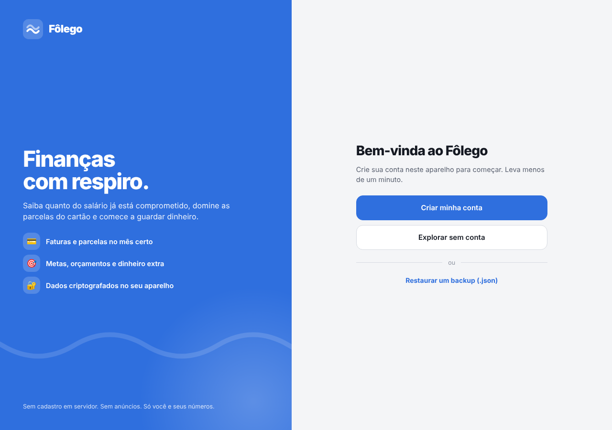
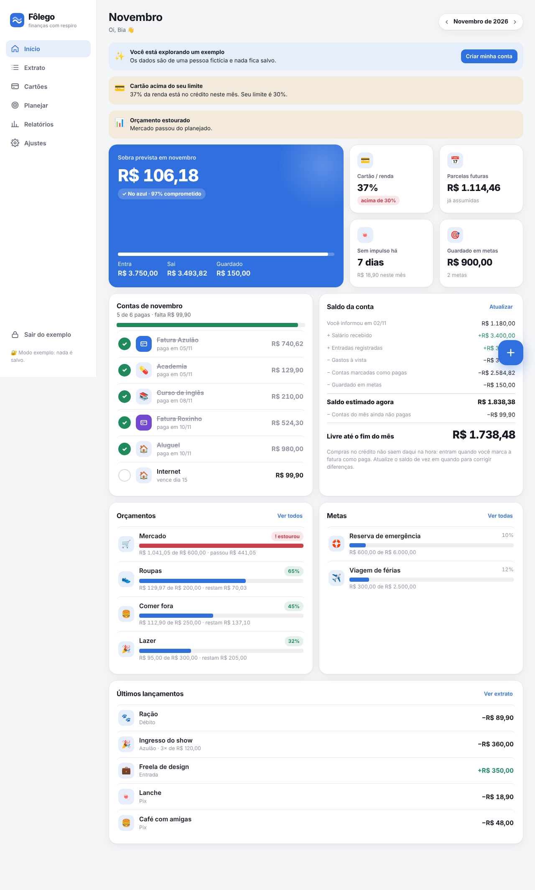
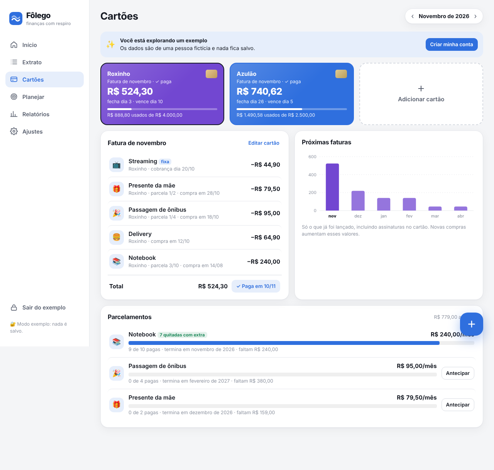

# 〰️ Fôlego

**Finanças com respiro.** Um app de finanças pessoais que cabe em um único arquivo HTML: sem cadastro, sem servidor e sem instalar nada. Seus dados ficam só no seu aparelho.

Feito para quem quer saber quanto do salário já está comprometido, depender menos do cartão de crédito e começar a guardar dinheiro.

## Login e privacidade

Ao abrir o Fôlego pela primeira vez, você cria uma conta **neste aparelho** com nome, renda e senha. Também dá para **explorar sem conta**, com dados de exemplo que não ficam salvos.

- **Não existe servidor.** A senha não é enviada nem guardada em lugar nenhum: ela vira a chave que **criptografa** os dados (AES-256-GCM, chave derivada com PBKDF2-SHA-256 e 310 mil iterações) antes de irem para o armazenamento do navegador. Sem a senha, os dados guardados são ilegíveis.
- **Manter conectada por 30 dias** é opcional. Com essa opção, a chave fica guardada no aparelho até você tocar em **Sair**.
- **Esqueceu a senha?** Não tem como recuperar. Por isso, exporte um backup de vez em quando (**Ajustes → Exportar backup**). O arquivo de backup **não** tem senha: guarde em lugar seguro.
- Em **Ajustes → Conta e segurança** você troca a senha ou sai da conta.

## As abas

| Aba | O que tem |
|---|---|
| **Início** | Sobra prevista (já descontando o que você guarda), % da renda no cartão, parcelas futuras, dias sem compra por impulso, **contas do mês para marcar como pagas**, **saldo real da conta** com quanto fica livre até o fim do mês, orçamentos, metas e alertas automáticos (mês no vermelho, cartão acima do limite, orçamento estourado, conta vencida) |
| **Extrato** | Dois modos: *Feitos no mês*, com o que você registrou, agrupado por dia, e *O que pesa no mês*, com salário, contas fixas, faturas que vencem e gastos à vista. Busca e filtros por tipo, categoria e forma de pagamento |
| **Cartões** | Cartões visuais com a fatura do mês e o limite usado, itens da fatura (com assinaturas), botão para marcar a fatura como paga, gráfico das próximas 6 faturas e parcelamentos com progresso e **antecipação de parcelas** (com desconto, se o banco der) |
| **Planejar** | **Orçamentos** por categoria · **Metas** com ícone, prazo e quanto guardar por mês · **Dinheiro extra** (13º, férias, bônus): cada destino pode **guardar numa meta** ou **quitar um parcelamento** sozinho quando marcado como pago · **Contas fixas e assinaturas**, inclusive no cartão de crédito |
| **Relatórios** | Linha do tempo de 12 meses (passado real + futuro já comprometido), comparação com o mês anterior, gastos por categoria e por forma de pagamento |
| **Ajustes** | Perfil e renda, limite de uso do cartão, saldo da conta, **modo claro, escuro ou automático**, **6 cores de tema**, **categorias personalizadas**, instalação no celular, backup e **importação de extrato em CSV** |

No celular, as abas viram uma barra inferior. O botão **+** lança um gasto ou uma entrada de qualquer tela. Excluiu algo sem querer? Toque em **Desfazer** no aviso que aparece embaixo.

## Como as contas funcionam

- **Débito, Pix e dinheiro** pesam no mês da compra.
- **Crédito:** uma compra feita no dia do fechamento ou depois cai na fatura seguinte, e o valor pesa no mês em que a fatura **vence**. Parcelas se espalham pelos meses seguintes. Os centavos que sobram da divisão vão para a última parcela.
- **Dinheiro extra não entra na renda do mês.** 13º e férias ficam numa área separada, onde você decide o destino de cada valor antes de ele cair na conta.
- **Assinaturas no cartão** entram na fatura como uma compra feita no dia da cobrança.
- **Antecipar parcelas** leva as últimas parcelas para a fatura escolhida (pesam naquele mês). **Quitar com dinheiro extra** tira as parcelas dos meses, porque são pagas com o 13º ou as férias.
- **Guardar do salário** desconta da sobra do mês. Guardar dinheiro extra não mexe na sobra.
- **Saldo da conta:** parte do último saldo que você informou, soma o salário e as entradas e desconta os gastos à vista, as contas marcadas como pagas e o que você guardou. Compras no crédito só saem quando a fatura é marcada como paga.
- **Dias sem impulso** contam a partir do último gasto na categoria 🍬 Impulso.

## Importar extrato (CSV)

Em **Extrato** ou **Ajustes → Importar extrato (CSV)**, escolha o arquivo exportado pelo banco. O Fôlego reconhece as colunas, aceita `;` ou `,`, datas `dd/mm/aaaa` ou `aaaa-mm-dd` e valores como `1.234,56`. Ele também sugere a categoria pela descrição, ignora o que já foi importado e mostra uma prévia antes de importar. Entradas (como o salário, que o app já conta) ficam de fora por padrão.

## Como usar

- **Online:** abra o link do GitHub Pages deste repositório.
- **Como app no celular:** no link do GitHub Pages, use *Adicionar à Tela de Início* (Safari, iPhone) ou *Instalar app* (Chrome, Android). Ele abre em tela cheia e funciona sem internet.
- **Sem instalar nada:** baixe o `index.html` e abra no navegador.

Na primeira vez, toque em **Começar** para usar com os seus dados ou em **Explorar com dados de exemplo** para ver o app funcionando com uma pessoa fictícia.

## Seus dados

Tudo fica criptografado no `localStorage` do navegador. Nada é enviado para servidor nenhum, e quem abrir o mesmo link não vê os seus dados.

- Para usar em outro aparelho, vá em **Ajustes → Exportar backup** e importe o arquivo no outro.
- Limpar os dados do navegador apaga tudo, então exporte um backup de vez em quando.
- ⚠️ Não suba o seu arquivo de backup `.json` para um repositório público.

## Publicar no GitHub Pages

1. Suba todos os arquivos para a raiz do repositório: `index.html`, `manifest.webmanifest`, `sw.js` e os ícones `.png`.
2. Vá em **Settings → Pages**.
3. Em **Source**, escolha **Deploy from a branch**, depois `main` e `/ (root)`.
4. Em alguns minutos o app fica em `https://SEU-USUARIO.github.io/NOME-DO-REPO/`.

> Ao publicar uma versão nova, mude `CACHE = "folego-v2"` no `sw.js` (por exemplo, para `v3`). Assim os celulares com o app instalado baixam a atualização.

## Tecnologia

HTML, CSS e JavaScript puro, sem frameworks nem build. O app é um único `index.html`; `manifest.webmanifest` e `sw.js` o tornam instalável e offline (PWA). Gráficos em SVG feitos à mão, fonte [Plus Jakarta Sans](https://fonts.google.com/specimen/Plus+Jakarta+Sans) e cores dos gráficos verificadas para daltonismo.

## Licença

[MIT](LICENSE)
